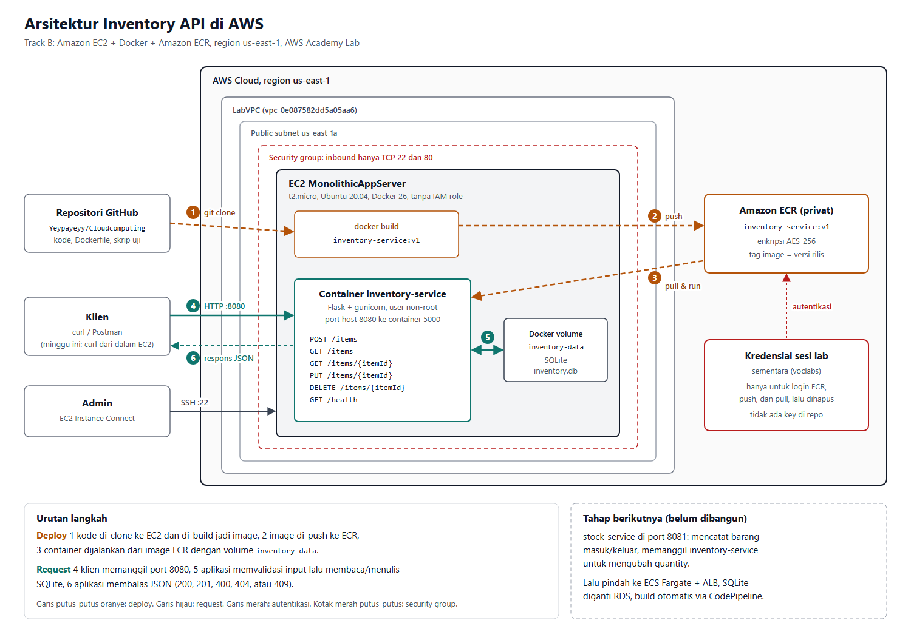

# Inventory API — Cloud Computing Week 12 (Track B: Containers)

REST API sederhana untuk mencatat stok barang di gudang/lab: tambah barang, lihat daftar, ubah jumlah/lokasi, dan hapus data. Dijalankan sebagai container Docker di Amazon EC2, image disimpan di Amazon ECR.

## Arsitektur



- **Compute:** Amazon EC2 (`MonolithicAppServer` bawaan lab) + Docker
- **Registry:** Amazon ECR privat — `inventory-service:v1`
- **Storage:** SQLite di Docker volume `inventory-data`
- **Service yang direncanakan:** `inventory-service` (sudah dibangun), `stock-service` (minggu depan)

## Entitas: Item

| Field | Tipe | Keterangan |
|---|---|---|
| `itemId` | string (UUID) | Primary key, dibuat otomatis |
| `name` | string | Wajib |
| `sku` | string | Wajib, unik |
| `category` | string | Opsional |
| `quantity` | integer ≥ 0 | Wajib |
| `location` | string | Opsional, lokasi rak/gudang |
| `createdAt`, `updatedAt` | ISO 8601 | Diisi otomatis |

## Endpoint

| Method | Path | Respons |
|---|---|---|
| `POST` | `/items` | 201 item baru · 400 data tidak valid · 409 SKU duplikat |
| `GET` | `/items` | 200 `{count, items}` |
| `GET` | `/items/{itemId}` | 200 item · 404 |
| `PUT` | `/items/{itemId}` | 200 item terbaru · 400 · 404 · 409 |
| `DELETE` | `/items/{itemId}` | 200 pesan konfirmasi · 404 |
| `GET` | `/health` | 200 status service |

## Menjalankan lokal

```bash
cd inventory-service
docker build -t inventory-service:v1 .
docker run -d -p 8080:5000 -v inventory-data:/data inventory-service:v1
../scripts/crud-test.sh http://localhost:8080
```

Tanpa Docker: `pip install -r inventory-service/requirements.txt` lalu `python inventory-service/test_app.py`.

## Deploy ke AWS

Lihat [docs/deployment-plan.md](docs/deployment-plan.md).

## Bukti AWS

Screenshot ada di folder [evidence/](evidence/).

## Struktur repo

```
inventory-service/   app Flask, Dockerfile, test
scripts/             crud-test.sh (uji CRUD via curl)
docs/                deployment plan, diagram arsitektur
evidence/            screenshot AWS
```
